# Термостат: железо и прошивка

Все материалы по железу взяты вот [отсюда](https://blog.softdev.online/index.php?controller=post&action=view&id_post=54).

### Данный проект подходит к термостатам.

- С оригинальной прошивкой они определяются в **z2m** так
	- "_TZE204_u9bfwha0"
	- "_TZE204_aoclfnxz"
	- "_TZE200_edl8pz1k"
	- "_TZE204_edl8pz1k"
- Внешний вид
	- 
- Плата
	- Смотри в разделе [Железо](#1-железо)
	
## Содержание

- [1. Железо](#1-железо)
- [2. Сборка проекта](#2-сборка-проекта)
- [3. Как обновить](#3-как-обновить)
  - [Этап 1. OTA-обновление ZT3L](#этап-1-ota-обновление-zt3l)
  - [Этап 2. Прошивка CA51F253L3](#этап-2-прошивка-ca51f253l3)

---

## 1. Железо

### Схема термостата

<div align="center">
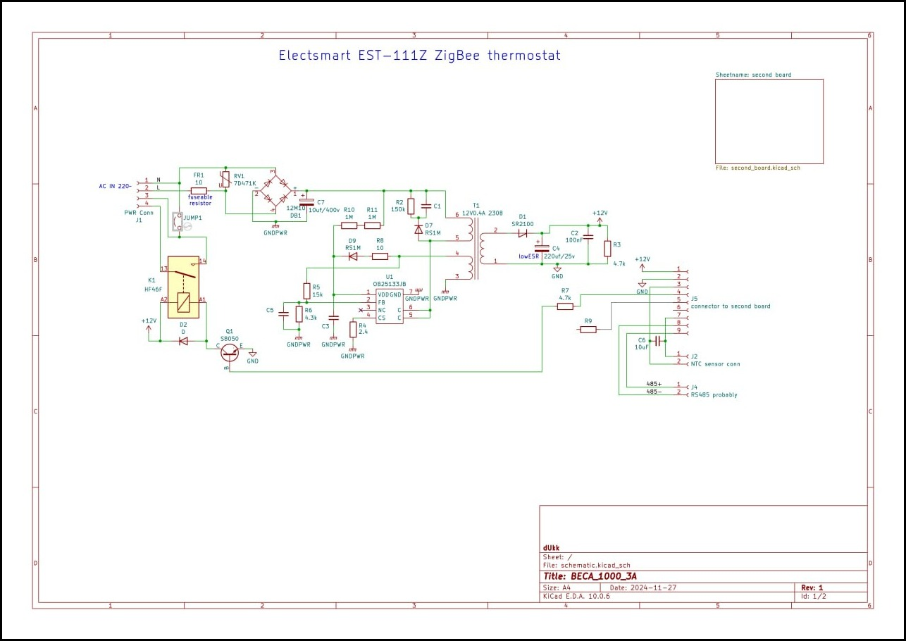 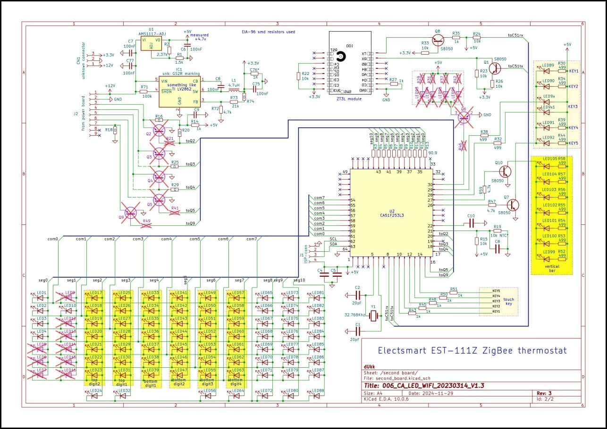
<p align="center"><em>Схема термостата: два фрагмента</em></p>
</div>

### Слаботочная плата термостата с экраном

<div align="center">
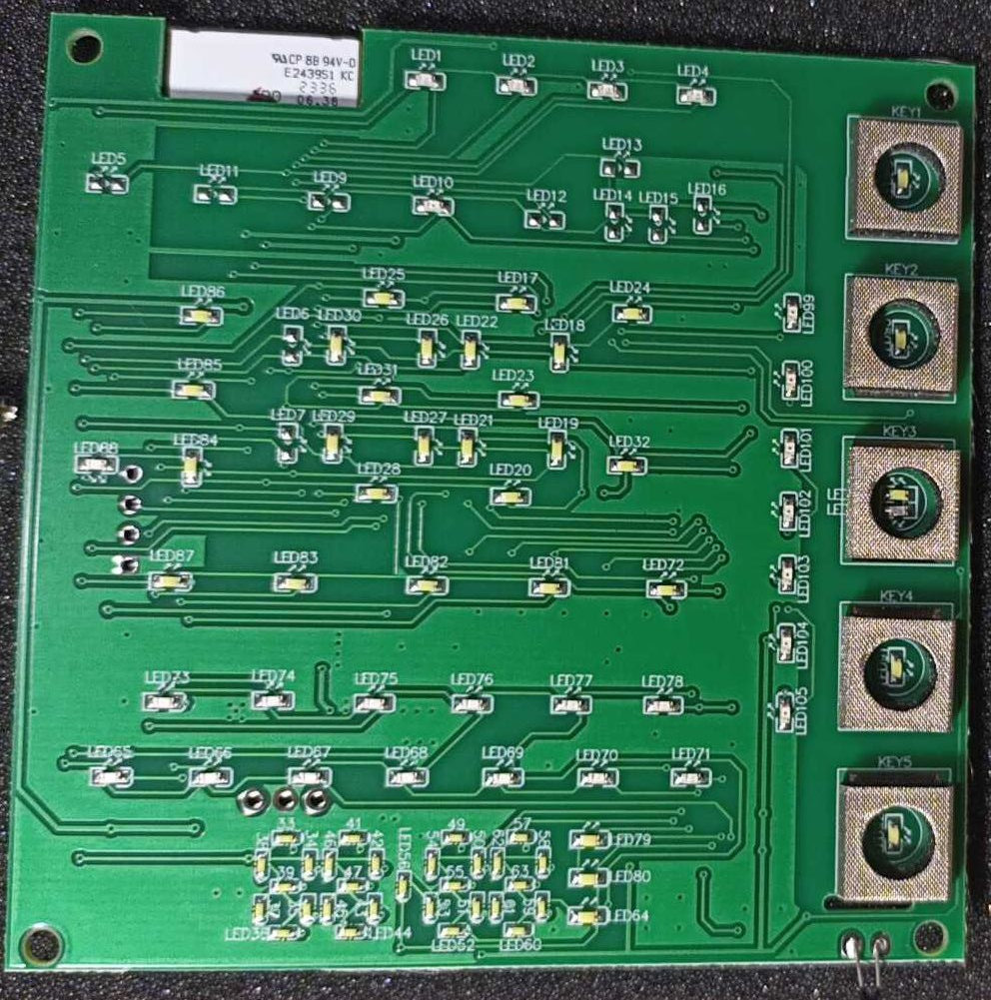 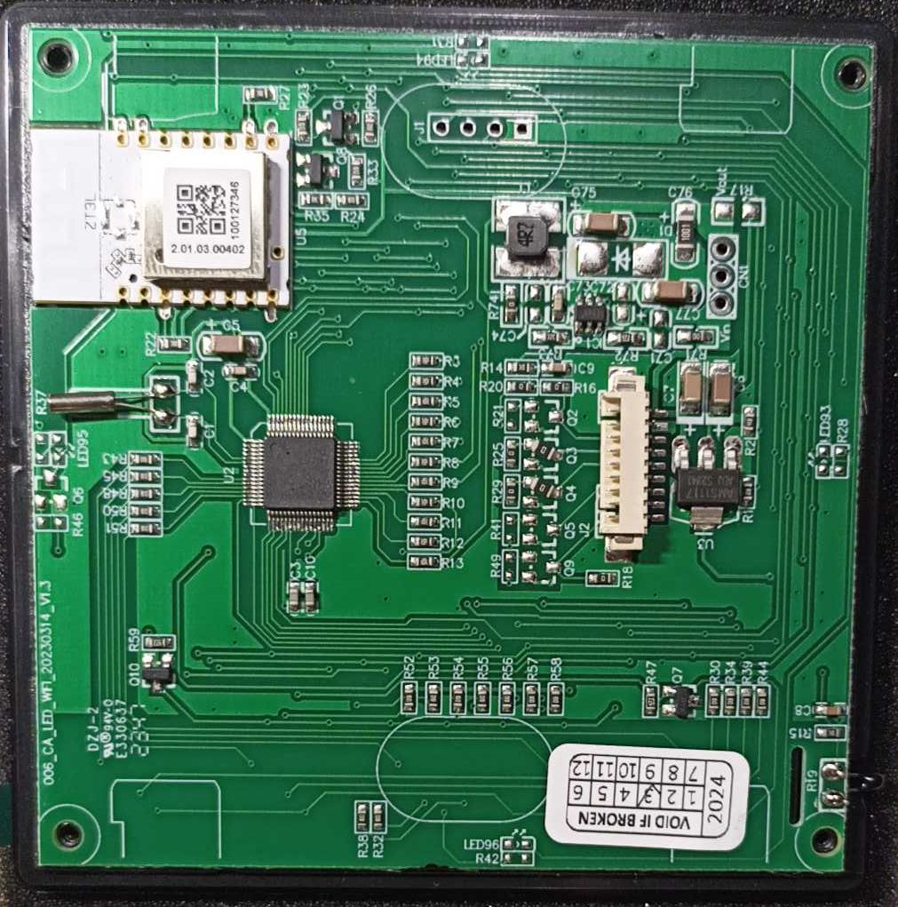
<p align="center"><em>Слаботочная плата: вид сверху и вид снизу</em></p>
</div>

---

## 2. Сборка проекта

### Инструменты

Для сборки проекта под Windows нужно скачать несколько инструментов.

| Инструмент | Обязательность |
| --- | --- |
| [clang](https://github.com/devbis/llvm-mcs51/releases) | обязательно |
| [SDCC](https://sdcc.sourceforge.net/snap.php) | опционально, по умолчанию сборка для **CA51F253L3** сделана на clang |
| [Telink IoT Studio](https://doc.telink-semi.cn/tools/telink_iot_studio/TelinkIoTStudio_V2025.2.zip) | обязательно |
| [Git for Windows](https://git-scm.com/install/windows?ref=faun) | рекомендуется |

В системе должен быть инсталлирован **python**.

Если нужно только прошить **CA51F253L3**, то **SDCC** и **Telink IoT Studio** можно не скачивать.

### Сборка

После установки всех компонентов запускаем **Git Bash** и переходим в папку проекта. Далее выполняем

```text
$ make bootloader clean all
```

Проверяем вывод компилятора. Должно собраться три основных файла - **bootloader** для **TLSR8258**, и две **firmware** для **TLSR8258** и **CA51F253L3**. Попутно еще создаются образы **ОТА**. Все будет лежать в директории **bin**.

---

## 3. Как обновить

Сразу скажу, обновить **CA51F253L3** по ОТА из оригинальной прошивки в кастомную нельзя. В протоколе Tuya есть такой механизм, но проектировщики этого термостата не реализовали такую возможность. Но с другой стороны, для перепрошивки **CA51F253L3** не нужен какой-то отдельный программатор. Достаточно обычного **USB-UART** адаптера.

Итак. Обновление будет происходить в два этапа. Сначала по **ОТА** обновляем zigbee-модуль ZT3L. А затем мы уже прошьем проводами **CA51F253L3**.

### Этап 1. OTA-обновление ZT3L

#### Шаг 1. Добавление оригинального термостата в z2m

У вас должно получиться что-то типа вот такого

<div align="center">
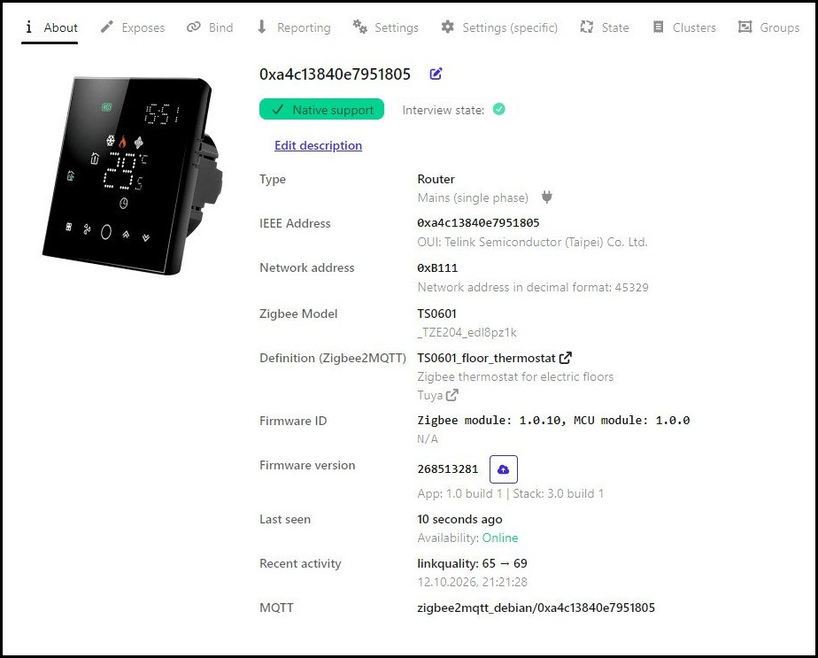
<p align="center"><em>Оригинальный термостат в z2m</em></p>
</div>

#### Шаг 2. Загрузка OTA-образа и запуск обновления

Далее жмем на синее облачко и выбираем **custom firmware** и добавляем **ОТА** образ для обновления - [1141-d3a3-1111114b-osrctherm_r02_zrd_ZT3L.zigbee](https://github.com/slacky1965/tuya_thermostat_full_custom_r02_zrd/raw/refs/heads/main/bin/1141-d3a3-1111114b-osrctherm_r02_zrd_ZT3L.zigbee) и жмем обновить.

<div align="center">
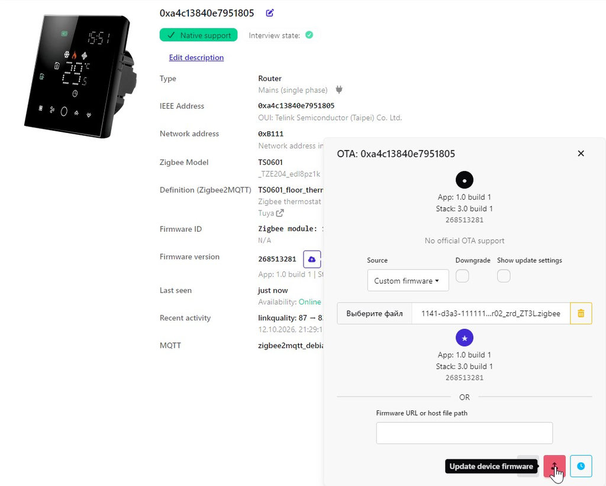
<p align="center"><em>Добавление OTA-образа в z2m</em></p>
</div>

#### Шаг 3. Проверка лога и результата

Далее в логе можно наблюдать отчеты об обновлении.

<div align="center">
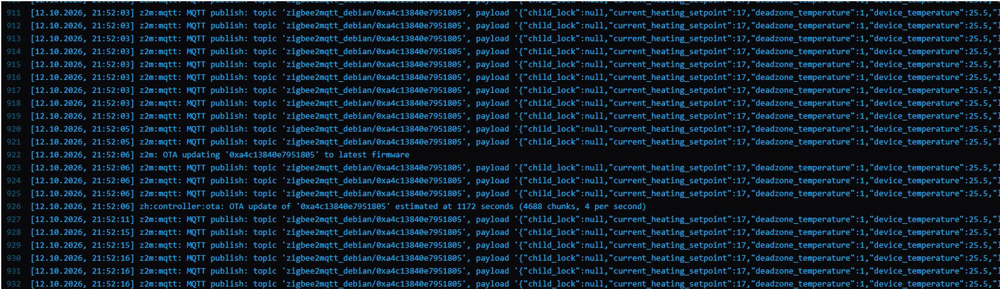
<p align="center"><em>Лог: обновление началось</em></p>
</div>

В процессе обновления в логе также можно увидеть информацию о кол-ве оставшихся секунд и процент загрузки.

<div align="center">
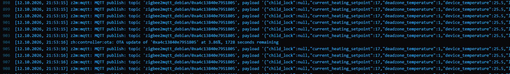
<p align="center"><em>Лог: оставшееся время и процент загрузки</em></p>
</div>

Также в логе можно наблюдать окончание обновления.

<div align="center">
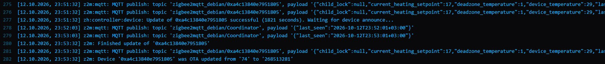
<p align="center"><em>Лог: обновление завершено</em></p>
</div>

После успешного обновления нужно разрешить добавление новых устройств в z2m и термостат сам подключится к сети уже с новым именем и адресом. Старую версию термостата принудительно удаляем. У вас должно получиться что-то в этом роде.

<div align="center">
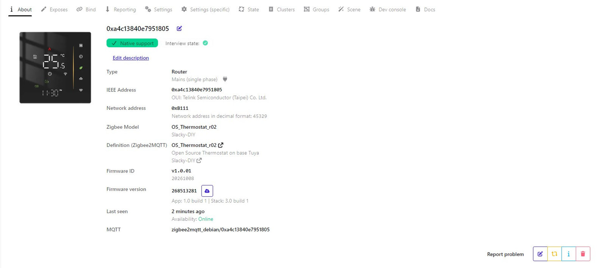
<p align="center"><em>Термостат после обновления в z2m</em></p>
</div>

### Этап 2. Прошивка CA51F253L3

Для этого нужно обесточить термостат.

> [!WARNING]
> Внимание!!! При отсоединенной слаботочной плате нельзя подавать питание на силовую часть термостата!!!

Нужно сдвинуть в сторону экран, отсоединить разъем и открутив 4 небольших самореза достать слаботочную плату. На ней нужно найти место с нераспаянным разъемом **J1**. Далее подключаем к **USB-UART** адаптеру согласно надписям на фото ниже - контакт **RX** на плате нужно подключать к **RX** адаптера, контакт **TX** на плате - к **TX** адаптера. Также подключаем **GND**, а вот **3v3** пока не подключаем.

<div align="center">
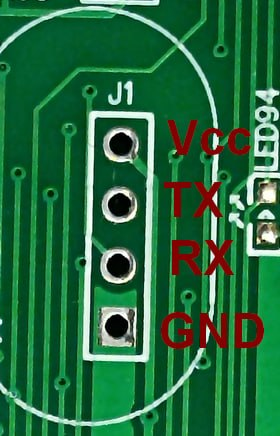
<p align="center"><em>Подключение <b>USB-UART</b> к разъему <b>J1</b></em></p>
</div>

Предварительно проверяем, на каком порту сидит **USB-UART** адаптер и редактируем в корне проекта в **makefile** параметр **CA51F2_PORT** на тот, который у вас.

<div align="center">
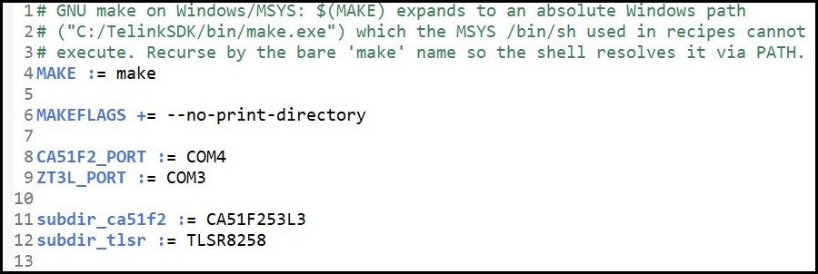
<p align="center"><em>Параметр <b>CA51F2_PORT</b> в <b>makefile</b></em></p>
</div>

Далее заходим в **Git Bash**, переходим в директорию проекта. И даем такую команду.

```text
$ make flash-cachip
```

> [!NOTE]
> Запускается небольшая программа на **python**'е, которая и прошивает **CA51F253L3**. Программа немного модифицирована под себя. Оригинал - [https://github.com/MrdUkk/cachip-ispuartflasher](https://github.com/MrdUkk/cachip-ispuartflasher)

Тут есть два варианта.

1. Чип прошьется.
2. Программа напишет, что она ожидает 4 секунды для сброса или подачи питания.

Если у нас второй вариант, то в эти 4 секунды мы подаем питание **3v3** (мы же помним, что его не подавали). В конце концов должно получиться следующее.

<details>
<summary>Пример вывода команды <b>make flash-cachip</b></summary>

```text
$ make flash-cachip
make -C CA51F253L3 PORT=COM4 flash-cachip
py ./tools/cachip-isp-serial_new.py COM4 upload ../bin/osrctherm_r02_v1.01_CA51F253L3.bin
using embedded phase1 bootloader (642 bytes)
opening serial port COM4
trying ISP-mode activation, waiting 4 seconds (if power is already applied, pulse RESET pin 2 low->high !)
MCU accepted connection
sending some magic cmd
got mcu success response
switching port speed
sending next magic cmd
got mcu response, asserting values
valid
sending our bootloader
got mcu success response
got mcu success response
got mcu success response
got mcu success response
got mcu success response
got mcu success response
reading hidden 0x2B area to identify the chip
chip identified: CA51F253L3, flash size 32768 bytes
requesting verify chipID for next phases
got mcu success response
requesting access to flash with designated chipID
got mcu success response
requesting onchip flash memory partial 229 sectors erase
got mcu success response
uploading from ../bin/osrctherm_r02_v1.01_CA51F253L3.bin to onchip memory
written 29206/29206 bytes (100%)
upload done: 29206 bytes written to onchip flash
sending session end cmd
got mcu success response
end, remove power from MCU
```

</details>

Все. На этом можно термостат собирать обратно.

## [Протокол обмена между ZT3L и CA51F253L3](serial.md)


